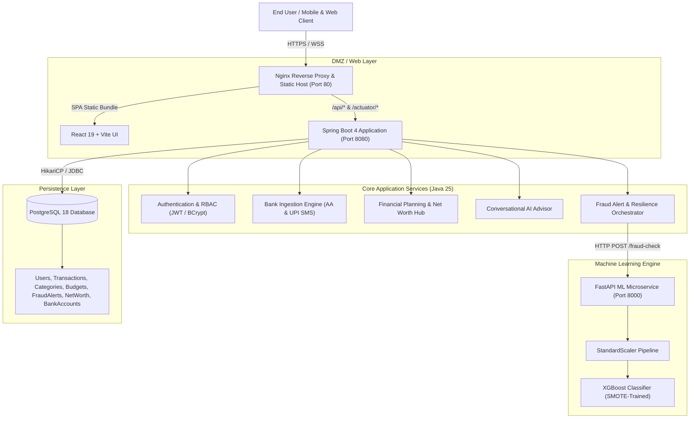
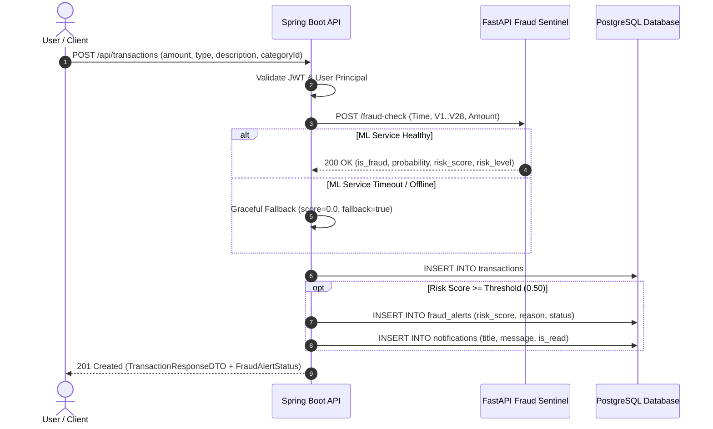
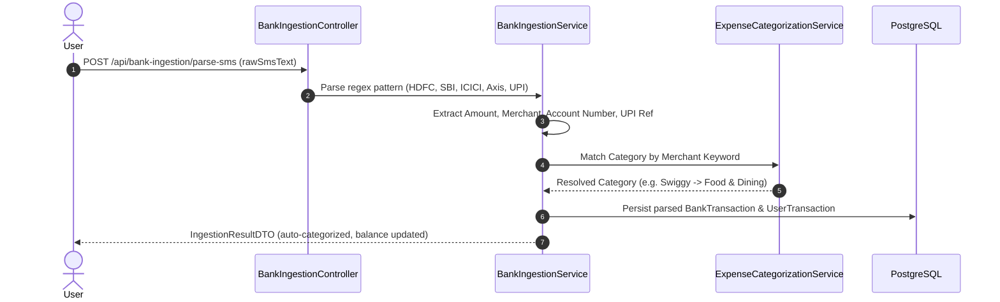

# PulseWallet System Architecture

PulseWallet is an enterprise-grade personal finance and automated fraud detection platform designed specifically for the modern Indian FinTech ecosystem. It features real-time anomaly detection, multi-source financial data ingestion (Account Aggregator & UPI SMS), conversational AI financial advisory, and deterministic wealth forecasting.

---

## 1. High-Level Architecture Overview

PulseWallet adopts a decoupled **4-Tier Microservices Architecture**:

1. **Presentation & Reverse Proxy Tier**: Single Page Application built on React 19 + Vite, served and reverse-proxied by Nginx with gzip compression, caching headers, and client-side routing.
2. **Application & Business Logic Tier**: Enterprise REST backend engineered with Spring Boot 4 and Java 25, utilizing Spring Security (stateless JWT), Spring Data JPA, and Flyway database migrations.
3. **Machine Learning Fraud Sentinel Tier**: Microservice built with Python 3.11, FastAPI, Scikit-learn, and XGBoost. Processes high-dimensional transaction telemetry in sub-15ms inference windows.
4. **Data Persistence Tier**: PostgreSQL 18 relational database with enforced referential integrity, automated Flyway migrations (V1 through V16), connection pooling via HikariCP, and user-scoped data isolation.

---

## 2. Component Breakdown

### 2.1 Frontend Client (`frontend/`)
- **Technology Stack**: React 19, Vite, Tailwind-inspired Vanilla CSS Design System, Lucide Icons, Recharts.
- **Routing & Navigation**: Client-side routing with protected routes (`ProtectedRoute`), stateful breadcrumb navigation, and contextual `Back` / `Next` workflows (`TabStepNav`).
- **State & API Handling**: Centralized API client (`api.js`) featuring Bearer token injection, automatic 401 token expiry interception, and granular error state handling.

### 2.2 Core Backend Application (`src/main/java/com/pulsewallet/pulsewallet/`)
- **Framework**: Spring Boot 4.1.0 on Java 25.
- **Security & Authorization**:
  - Stateless Bearer authentication using JJWT (`0.12.6`).
  - Strict Cross-Origin Resource Sharing (CORS) white-listing.
  - Inherent Insecure Direct Object Reference (IDOR) defense: all SQL queries and service mutations enforce `userId = authenticatedUser.getId()`.
- **Database Migrations**: 16 versioned Flyway migrations ensuring reproducible schema state across environments.
- **Resilience Engineering**:
  - `RestClient` with configured connection and read timeouts.
  - Fallback logic: if the Python ML engine is unreachable, transactions are safely processed with a `DEGRADED` fallback flag rather than blocking user operations.

### 2.3 Machine Learning Fraud Sentinel (`fraud-detection/`)
- **Framework**: Python 3.11, FastAPI, Pydantic, Scikit-learn, XGBoost, Imbalanced-learn.
- **Model Pipeline**:
  - Input: 30 numerical features (`Time`, `V1`–`V28` PCA features, `Amount`).
  - Preprocessor: Fitted `StandardScaler` on `Time` and `Amount`.
  - Classifier: 100-estimator gradient boosted trees trained on SMOTE-oversampled credit card transaction dataset.
  - Latency: < 15ms median inference latency.
  - Output: Fraud classification flag, raw fraud probability, continuous risk score (0–100), and categorical risk tier (`LOW`, `MEDIUM`, `HIGH`, `CRITICAL`).

---

## 3. Core Data Flows

### 3.1 Transaction Ingestion & Real-Time Fraud Evaluation

### 3.2 Indian Bank Ingestion (Account Aggregator & UPI SMS Parsing)

---

## 4. Security & Network Architecture

### 4.1 Security Boundaries
| Layer | Defense Mechanism | Details |
|---|---|---|
| **Edge / Ingress** | Nginx Proxy | Hides internal topology, enforces SSL termination, rejects malformed HTTP headers |
| **API Transport** | CORS Policy | Restricts browser origins to authorized production domain list (`CORS_ALLOWED_ORIGINS`) |
| **Authentication** | JJWT (HS256) | Minimum 256-bit cryptographically secure key; tokens expire in 60 minutes |
| **Authorization** | Spring Security 6 | Every endpoint (except `/api/auth/**`, `/api/health`, `/actuator/**`) requires authenticated principal |
| **Data Isolation** | Repository IDOR Guards | Queries strictly partition records: `SELECT t FROM Transaction t WHERE t.user.id = :userId` |
| **Password Storage** | BCrypt (Cost 10) | One-way salt-hashed passwords; raw strings never persisted or logged |
| **Model Boundary** | Pydantic Schema | Input sanitization and numerical clamping before feeding ML tensor |

### 4.2 Network Topology & Ports

| Service | Internal Docker Host | Container Port | Exposed Host Port | Protocol |
|---|---|---|---|---|
| Frontend (Nginx) | `pulsewallet-frontend` | 80 | `80` (or `5173` dev) | HTTP/1.1 |
| Core Backend | `pulsewallet-backend` | 8080 | `8080` | HTTP/1.1 REST |
| ML Fraud Sentinel | `pulsewallet-fraud-detection` | 8000 | `8000` | HTTP/1.1 REST |
| Relational Database | `pulsewallet-postgres` | 5432 | `5432` | TCP PostgreSQL |
| pgAdmin (Tools) | `pulsewallet-pgadmin` | 80 | `5050` | HTTP/1.1 |

---

## 5. Storage & Database Schema

The database relies on 16 Flyway migrations ensuring automated schema consistency:
- `V1`: Core users, roles, password hashes.
- `V2`: Transactions table with amounts, categories, timestamps.
- `V3`: System and custom categories.
- `V4`: Budget limits per category and month.
- `V5`: Default system categories seeding.
- `V6`: Custom user categories index.
- `V7`: Travel & Transportation default category addition.
- `V8`: Fraud alerts table with risk scores and transaction references.
- `V9`: In-app notification center table.
- `V10`: Monthly financial forecast table.
- `V11`: Financial advisory rules and guidance history.
- `V12`: Net worth tracking, assets, and liabilities.
- `V13`: Account Aggregator bank accounts and consent tracking.
- `V14`: Bank ingested raw transactions and reconciliation status.
- `V15`: AI financial assistant conversation sessions and message audit.
- `V16`: Indian Financial Hub tax profiles (Section 80C, 80D, NPS) and SIP goals.
